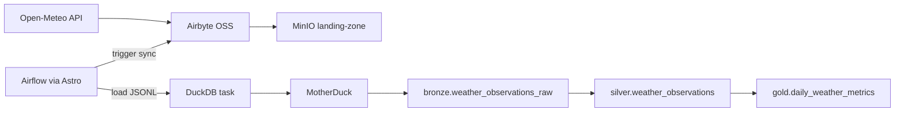

# Modern Data Orchestrator

Local portfolio project for practicing production-style data orchestration with
free and open-source tools.

## What This Demonstrates

This project mirrors a medallion-style data platform in a local environment:

- Airflow schedules and observes the pipeline.
- Airbyte extracts public weather data and lands it in object storage.
- MinIO acts as the local S3-compatible landing zone.
- DuckDB loads landed JSONL files and writes modeled tables to MotherDuck.
- SQL transforms raw records into bronze, silver, and gold layers.

## Architecture



## Project Layout

```text
.
├── dags/                         # Airflow DAG definitions
├── docs/                         # Setup, smoke tests, screenshot walkthrough
├── include/
│   ├── sample_data/              # Fallback sample JSONL
│   ├── scripts/                  # Airbyte, MinIO, and MotherDuck helpers
│   └── sql/                      # Bronze, silver, and gold SQL
├── infra/                        # MinIO compose and Airbyte abctl scripts
├── tests/                        # Fast unit and contract tests
├── airflow_settings.yaml
├── Dockerfile
├── packages.txt
└── requirements.txt
```

## First-Time Setup

You need:

- [Docker Desktop](https://docs.docker.com/get-started/get-docker/) or Docker Engine. MinIO, Airbyte, and Airflow all run in containers. Give Docker at least 8 GB of memory; Airbyte and Airflow run at the same time.
- Python 3, for the local virtualenv used by tests and the sample-data seed.
- The [Astro CLI](https://www.astronomer.io/docs/astro/cli/install-cli) and [abctl](https://docs.airbyte.com/platform/deploying-airbyte/abctl/).

On macOS with Homebrew, install the CLIs and keep Astro on Docker (the Homebrew formula installs Podman unless you opt out):

```bash
brew tap astronomer/tap
brew install astronomer/tap/astro --without-podman
brew tap airbytehq/tap
brew install abctl
astro config set container.binary docker -g
```

On Linux or Windows, use the install pages linked above, then point Astro at Docker if it is not already the default:

```bash
astro config set container.binary docker -g
```

Install Python dependencies from the repository root. If pip is pointed at a private index and returns `401`, force public PyPI for this virtualenv:

```bash
python3 -m venv .venv
. .venv/bin/activate
PIP_INDEX_URL=https://pypi.org/simple/ PIP_EXTRA_INDEX_URL= pip install -U pip -r requirements.txt
```

Create a free [MotherDuck](https://motherduck.com/) account. In the MotherDuck UI, open the organization menu, choose **Settings**, then **Create token**. Copy that token once; MotherDuck shows it only at creation time. The steps are also in [Authenticating to MotherDuck](https://motherduck.com/docs/key-tasks/authenticating-and-connecting-to-motherduck/authenticating-to-motherduck/).

Create local environment config and paste the token:

```bash
cp .env.example .env
```

Set `MOTHERDUCK_TOKEN` in `.env`. Set `MOTHERDUCK_DATABASE` to the database name shown under **Databases** in the MotherDuck UI. New accounts usually have `my_db`. Use that name, not the DAG id `modern_data_orchestrator`.

Leave the Airbyte fields empty until the connection exists. You will fill `AIRBYTE_USERNAME`, `AIRBYTE_PASSWORD`, and `AIRBYTE_CONNECTION_ID` in the next sections.

## Start Local Services

From the repository root, start MinIO:

```bash
docker compose -f infra/docker-compose.yaml up -d
```

Start Airbyte OSS. The script prints a username and password at the end:

```bash
bash infra/start_airbyte.sh
```

Copy that username and password into `.env` as `AIRBYTE_USERNAME` and `AIRBYTE_PASSWORD`. The same pair signs in to the Airbyte UI at `http://localhost:8000`, and the DAG sends it to the Airbyte API. Run `abctl local credentials` any time you need to see them again.

`.astro/` is gitignored, so each clone needs one init before Airflow will start. From the repository root:

```bash
astro dev init -f
astro dev start
```

`astro dev init -f` creates `.astro/config.yaml`. If it also creates `dags/exampledag.py`, delete that file. It targets a different Airflow SDK than this project.

## Configure Airbyte

Follow [`docs/airbyte_setup.md`](docs/airbyte_setup.md) to create:

- An Open-Meteo public API source.
- A MinIO S3-compatible destination.
- A connection with JSONL output.

Copy the Airbyte connection id into `AIRBYTE_CONNECTION_ID` in `.env`.

Airflow reads `.env` when its containers start. After the username, password, and connection id are saved, reload them:

```bash
astro dev restart
```

## Run The Pipeline

Open the Airflow UI and trigger:

```text
modern_data_orchestrator
```

The DAG performs:

1. Runtime config validation.
2. Airbyte sync trigger.
3. Airbyte job polling.
4. Bronze table preparation.
5. MinIO JSONL load into MotherDuck.
6. Silver deduplication and cleaning.
7. Gold daily metric aggregation.

## Validate Results

In the MotherDuck SQL UI, set the session to the same DB as `MOTHERDUCK_DATABASE`
(for example run `USE my_db;` first), then:

```sql
SELECT COUNT(*) AS bronze_rows FROM bronze.weather_observations_raw;
SELECT COUNT(*) AS silver_rows FROM silver.weather_observations;
SELECT COUNT(*) AS gold_rows FROM gold.daily_weather_metrics;
SELECT * FROM gold.daily_weather_metrics ORDER BY observation_date DESC LIMIT 10;
```

For the full runbook (including `USE` / three-part names), use
[`docs/smoke_test.md`](docs/smoke_test.md).

**Screenshots (each system in context):** [`docs/screenshots.md`](docs/screenshots.md).

## Reruns: what persists vs what you restart

You do **not** start from zero every time if you keep local state and your **`.env`**
on disk (`.env` is gitignored—back up tokens and ids in a password manager if you
clone the repo elsewhere).

| Layer | What survives | Typical “next session” |
| --- | --- | --- |
| **Repo** | DAGs, SQL, tests, docs | `git pull` / edits as usual |
| **`.env`** | On your machine only | Same file; after edits, `astro dev restart` |
| **MinIO** | Data in the Docker **volume** until you remove it | `docker compose -f infra/docker-compose.yaml up -d` (no `-v`). **Avoid** `docker compose down -v` if you want to keep landed files |
| **MotherDuck** | Tables in **`my_db`** (and your token until revoked) | Nothing to start; optional `USE my_db;` then queries or re-run the DAG to refresh data |
| **Airbyte (abctl)** | Kind cluster + Helm release often stay on disk between runs | `bash infra/start_airbyte.sh` again after reboot; **connections remain** unless you delete the cluster or run a full abctl teardown |
| **Airflow (Astro)** | Code in repo; `.astro/` is local | `astro dev start` from the repository root; run **`astro dev init -f`** only on a fresh clone |

**Fast path after a reboot:** MinIO compose up → `start_airbyte.sh` → `astro dev start` → trigger **`modern_data_orchestrator`**. You only re-do Airbyte UI work if you wiped the cluster or created a **new** connection (then update **`AIRBYTE_CONNECTION_ID`**).

**Intentional clean slate:** `docker compose … down -v` clears the MinIO volume. Drop the MotherDuck schemas to reset warehouse tables, or remove the abctl kind cluster to reset Airbyte connections.

## Testing

Run fast tests from the project root:

```bash
pytest
```

The tests cover config defaults, Airbyte response parsing, JSONL-to-bronze row
mapping, and SQL layer contracts. DAG import tests are skipped automatically if
Airflow is not installed in the current Python environment.

## Design Notes

- Keep source paths, target names, and schemas explicit.
- Add load metadata such as `loaded_at_ts`.
- Use environment-driven naming instead of hardcoded paths.
- Keep SQL explicit and avoid `SELECT *`.
- Separate fast unit tests from slower integration checks.
