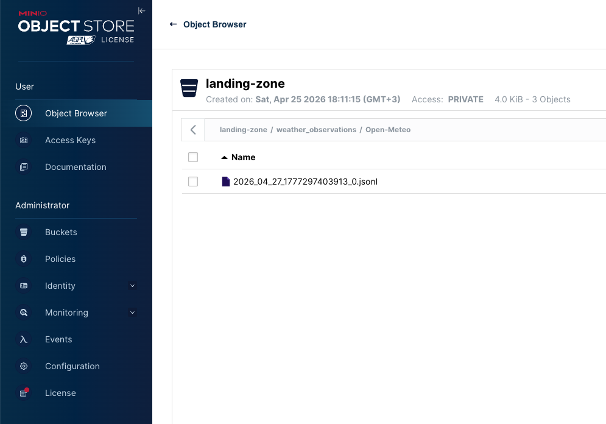
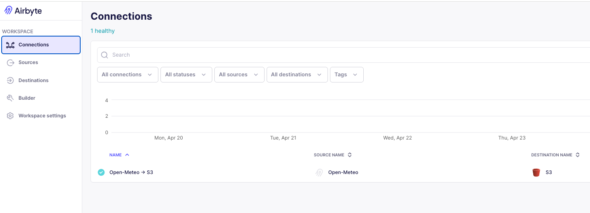
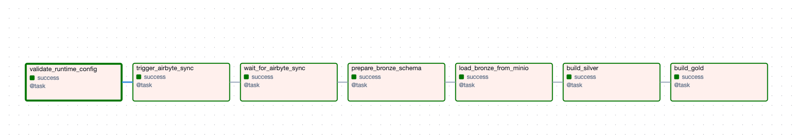
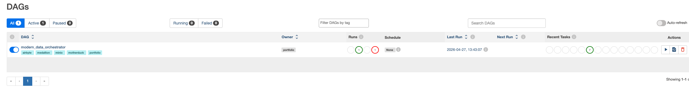
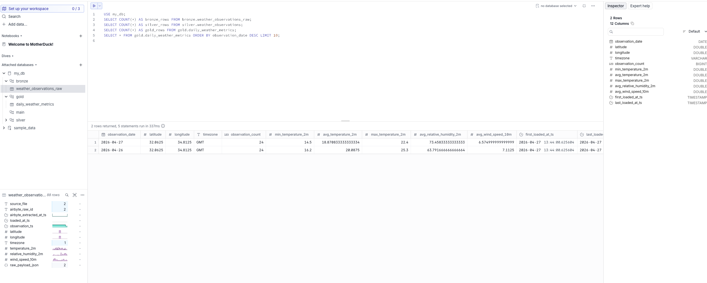

# Pipeline in pictures

This page walks through **each layer of the stack** as implemented in this repo:
public weather data → **Airbyte** → **MinIO** (S3-compatible landing) → **Airflow**
orchestration → **MotherDuck** medallion tables (`bronze` / `silver` / `gold`).
Screenshots live in [`images/`](images/).

**IDE preview (Cursor / VS Code):** use **`./images/...`** and standard **Markdown**
image syntax below. That resolves next to this file (`docs/screenshots.md`). If
previews are still blank, open the **`modern-data-orchestrator`** folder as the
workspace root (not a single detached file). **GitHub** renders the same paths
when you view this file on github.com.

---

## 1. MinIO — landing zone

**Role:** S3-compatible object storage on the host. Airbyte writes **JSONL** under
the bucket prefix configured in your destination (for example
`weather_observations/…`), and the Airflow task **`load_bronze_from_minio`** reads
those keys via the same prefix in `.env` (`MINIO_AIRBYTE_PREFIX`).

**What to notice:** bucket name, prefix folders, and `.jsonl` objects after a
successful sync.



---

## 2. Airbyte — ingest to object storage

**Role:** Extract from the Open-Meteo HTTP source (Connector Builder) and load
into the **S3 destination** pointing at MinIO (`host.docker.internal:9000`).
Airflow triggers the connection by id (`AIRBYTE_CONNECTION_ID`).

**What to notice:** connection status, sync history, or destination test view
aligned with `docs/airbyte_setup.md`.



---

## 3. Airflow — orchestrate and transform

**Role:** DAG **`modern_data_orchestrator`** validates config, triggers and polls
Airbyte, runs bronze DDL, loads JSONL from MinIO into MotherDuck, then executes
silver and gold SQL.

**What to notice:** task graph / grid, green path through Airbyte tasks into
warehouse tasks, and (if captured) a successful task log for **`trigger_airbyte_sync`**.





---

## 4. MotherDuck — medallion warehouse

**Role:** Hosted DuckDB. **`prepare_bronze_schema`** creates `bronze.weather_observations_raw`;
downstream SQL builds **`silver.weather_observations`** and **`gold.daily_weather_metrics`**.
Use **`USE my_db;`** (or your `MOTHERDUCK_DATABASE`) in the SQL UI so `bronze`
resolves; see `docs/smoke_test.md`.

**What to notice:** schemas in the tree, row counts, or sample **`gold`** rows.



---

## Replacing or extending captures

| File | Suggested focus |
| --- | --- |
| `./images/minio.png` | Bucket + prefix + objects after sync |
| `./images/airbyte.png` | Connection, sync success, or destination settings |
| `./images/airflow1.png` | DAG graph or grid (overview) |
| `./images/airflow2.png` | Task instance, logs, or zoomed graph |
| `./images/motherduck.png` | `my_db` → gold / validation query |

Overwrite files in **`docs/images/`** keeping the same names, or add new files and
new lines here using:

```markdown

```

From **`README.md`** (repo root), use **`docs/images/<file>.png`** instead of `./images/`.

**Optional width on GitHub only:** HTML is supported on GitHub if you need a max
width, e.g. `` — some IDE
previews handle that worse than Markdown ``, so this doc sticks to Markdown
for portability.

---

## README architecture diagram

The Mermaid diagram in the root **`README.md`** renders on GitHub automatically—no
PNG required unless you want a static export for slides.
